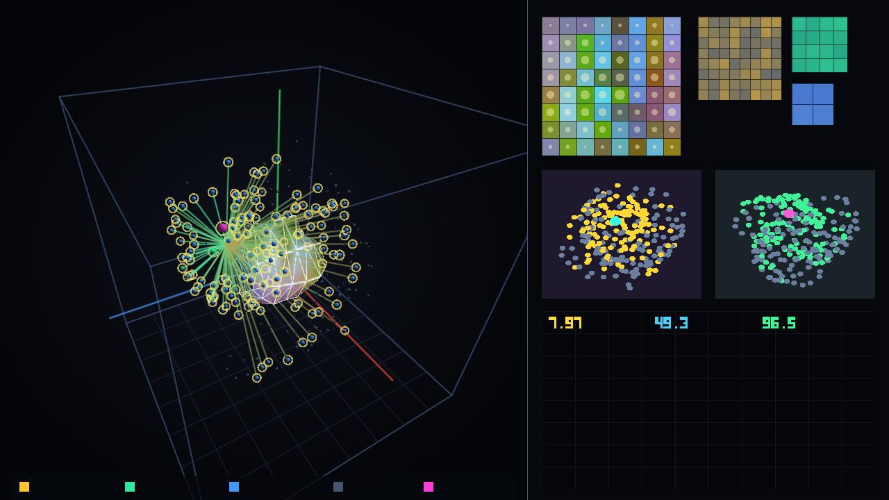
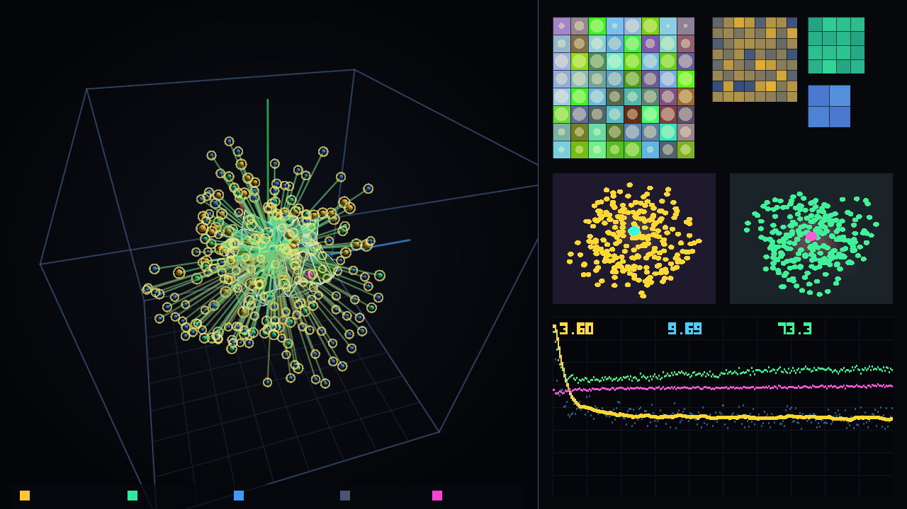
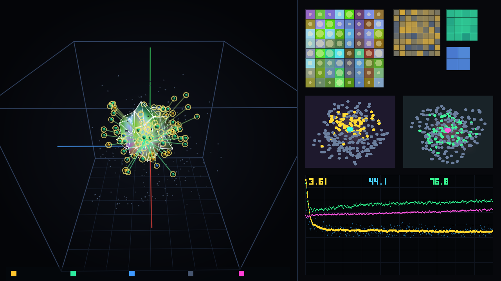

# MarkovMembrane Engine

Репозиторий Андрея Иванченкова для проверки архитектуры вычислений в 3D-пространстве через 2D-коллизию на границе сред, перспективу и уровни детализации (LOD) вместо перемножения плотных матриц и линейно растущего `KV-cache`.  
Все проверки выполнены на MacBook Pro (Intel Core i9-9880H, 16 ГБ RAM, видеокарта `AMD Radeon Pro 5500M` 4 ГБ VRAM).

Полная история изменений по всем версиям (`v0`–`v14`), найденным ошибкам и внесённым исправлениям вынесена в [`CHANGELOG.md`](CHANGELOG.md).  
Все текстовые логи запусков лежат в папке [`logs/`](logs/), а JSON-отчёты проверок, карта источников чисел [`review_package/field_to_source_map.md`](review_package/field_to_source_map.md) и массивы пер-байтовых потерь — в [`audit/`](audit/) и [`review_package/`](review_package/).

> **Примечание об истории коммитов:**  
> Первые 12 версий (`v0`–`v11`) изначально выгружались в репозиторий одним пакетом, поэтому эволюция проекта отражена не в датах первых коммитов, а в коде веток `iter-00`…`iter-14`, истории изменений [`CHANGELOG.md`](CHANGELOG.md), логах [`logs/`](logs/) и JSON-отчётах с фиксированными сидами.

---

## Суть авторской архитектуры

1. **2D-интерфейс с состоянием между внутренним и внешним слоями**:
   - Поверхность мембраны — марковский интерфейс, точка коллизии и место пересечения внутренней и внешней сложности.
   - Поверхность не сворачивается в 3 числа центроида: она представлена двоичной иерархией площадок (`SurfaceHierarchyTree`), где каждая площадка хранит как свою геометрию (3D-центр, радиус охватывающей сферы, нормаль, площадь), так и **состояние** (монопольную мощность, среднее расхождение и дипольный момент состояния вокруг центра площадки по FMM).
   - Усреднение площадок запускается **только от перспективы** по геометрическому критерию близости Барнса–Хата (`radius(g) / dist < theta`), без взвешивания по ошибке.
2. **Признак как полный набор векторов (без сжатия в 3 числа)**:
   - Три координаты в 3D-комнате задают положение объекта и расстояние до площадок интерфейса.
   - Внутри каждого 3D-признака хранится полный набор из 64 чисел, уложенный в безматричную пирамиду Хаара (от нулевого монополя `m = 1` до `m = 64`).
3. **Критерий ошибки взаимодействия и точная граница при деформации (`v14`)**:
   - Если объект приближается, число одновременно обрабатываемых деталей в признаке растёт; если он далеко — признак сворачивается в точку (монополь `c_0`).
   - Срез пирамиды определяется двусторонним правилом по верхней границе ошибки вклада самого признака в коррекцию состояния (`B_j(m) = sqrt(E'_j(m)) * ||obj_in_j[tail m:]||_2 * ||obj_out_j||_2`), а при деформации мембраны граница ошибки хвоста обновляется инкрементально через норму приращения сигнала `||delta_s||_2` без ручных запасов.
4. **Каскад до сходимости и постоянная память состояния вместо растущего `KV-cache`**:
   - Глубина каскада столкновений определяется сходимостью по неизрасходованному остатку энергии.
   - В безматричных версиях `v12`–`v14` на Vulkan API (`0 GEMM / 0 matmul`) поля среды хранятся в воксельной 3D-текстуре видеокарты и читаются аппаратным блоком `TMU`, а след контекста записывается прямо в воксели среды.

---

## Раздельная отчётность по движкам (Задача `F6`: без смешивания разных движков и бюджетов)

В соответствии с правилом `F6` каждое значение `BPC` приводится строго внутри своего движка с явным указанием бюджета обучения в байтах, числа сидов и размера состояния/параметров.

### Движок 1: Счётная таблица частот `n-gram` без обучаемых параметров (Задача `T2`)
- **Движок:** табличный счётчик с интерполяционным сглаживанием (`audit/run_T1_T2_verification.py`).
- **Бюджет обучения:** `1 502 836` байт (`1,0` эпоха среза `WikiText-2`), **обучаемых параметров:** `0`, **сидов:** `1` (детерминированно), **полная валидация:** `250 352` байта (`vocab = 256`, `OOV = 0`).

| Порядок `n-gram` | Бюджет обучения (байт) | Сидов | Обучаемых параметров | Полная валидация (`n_bytes`) | `BPC` (`mean ± SE`) | Перплексия байта (`PPL`) |
|---|---:|---:|---:|---:|---:|---:|
| `1-gram` | 1 502 836 | 1 | 0 | 250 352 | `4,6048 ± 0,00370` | `24,33` |
| `2-gram` | 1 502 836 | 1 | 0 | 250 352 | `3,5610 ± 0,00381` | `11,80` |
| `3-gram` | 1 502 836 | 1 | 0 | 250 352 | `3,0154 ± 0,00440` | `8,09` |
| `4-gram` | 1 502 836 | 1 | 0 | 250 352 | `2,5840 ± 0,00516` | `6,00` |
| `5-gram` (пол `T2`) | 1 502 836 | 1 | 0 | 250 352 | **`2,3806 ± 0,00594`** | `5,21` |

---

### Движок 2: Побайтовый движок `cpp_task2` (`review_package/run_task2_nanite_lod_complete.cpp`, Задания 2 и 3)
- **Движок:** безматричный C++-движок (`0 GEMM`), пирамида Хаара за `O(64)` сложений, дерево площадок поверхности `SurfaceHierarchyTree` (127 узлов с состоянием и дипольным моментом), каскад до сходимости и критерий ошибки взаимодействия `B_j(m)`.
- **Бюджет обучения эталона:** `60 000` байт (`0,0399` эпохи `WikiText-2`), **размер модели:** `39 201` параметр (`96` объектов по `64` числа), **полная валидация:** `250 352` байта.

#### 2.1. Кривая точности аппроксимации (Задача `S3` / `F3` / `F9`: объём вычисления и чтения памяти против ошибки огрубления)

| Порог `tau_int` | Средняя глубина `mean_m` (из 64) | Ошибка на валидации `BPC` | Отклонение огрубления `delta_BPC` | Операций по счётчику (`mac_counted / шаг`) | Прочитано байт весов (`bytes_read / токен`) | Сокращение чтения весов к `m = 64` |
|---:|---:|---:|---:|---:|---:|---:|
| `0,00000` (эталон `m = 64`) | `64,00` | `5,29282 ± 0,00353` | `0,00000` | `71 263` | `49 152` | `1,00×` |
| `0,00001` | `4,94` | `5,29282` | `0,00000` | `42 890` | `3 792` | `12,96×` |
| `0,01500` | `4,80` | `5,29282` | `0,00001` | `42 822` | `3 683` | `13,35×` |
| `0,06000` | `3,66` | `5,29288` | `0,00006` | `42 277` | `2 807` | `17,51×` |
| **`0,18000` (рабочая точка `tau_int* <= SE`)** | **`3,49`** | **`5,29340`** | **`0,00059` (`<= SE 0,00353`)** | **`42 198`** | **`2 680`** | **`18,34×` (в `1,69×` меньше всех операций)** |
| `0,50000` | `2,62` | `5,38822` | `0,09540` | `41 739` | `2 014` | `24,41×` |
| `1,40000` | `1,50` | `5,89095` | `0,59814` | `41 178` | `1 148` | `42,82×` |
| `3,80000` (монополь `m -> 1`) | `1,01` | `6,25681` | `0,96400` | `40 729` | `776` | `63,34×` |

*Формулировка по правилу `F3`:* при средней глубине `mean_m = 3,49` коэффициентов из `64` ошибка огрубления составляет `0,00059` бит/байт (внутри стандартной погрешности `SE = 0,00353`), объём вычисления по счётчику равен `42 198` операций/шаг (против `71 263` при `m = 64`), а чтение весов из памяти составляет `2 680` байт/токен (против `49 152` байт при `m = 64`).

#### 2.2. Контроль по памяти и параметрам `2×2` на 5 сидах (Задача `F5`, движок `cpp_task2`, бюджет `20 000` байт на сид, сиды `1, 2, 3, 4, 5`)

| Архитектура в `cpp_task2` | Параметров | Состояние `64` числа на поток (`BPC mean ± std` по 5 сидам) | Состояние `6 208` чисел на поток (`96×64 + 64`, `BPC mean ± std` по 5 сидам) |
|---|---:|---:|---:|
| Мембрана с иерархией площадок | `39 201` | `5,2090 ± 0,0273` | `5,2103 ± 0,0171` |
| Классический контроль (`ClassicalControlEngine`) | `28 672` | `4,9745 ± 0,0011` | `4,9756 ± 0,0010` |

---

### Движок 3: Безматричный GPU-движок на Vulkan 1.2 (`vulkan_v12`, `vulkan_v13`, `vulkan_v14`, видеокарта `AMD Radeon Pro 5500M`)
- **Движок:** вычислительные шейдеры `Vulkan 1.2 (SPIR-V)` (`0 GEMM / 0 matmul`), воксельная 3D-текстура среды `TMU` ($8\times 8\times 8$ `RGBA32F`), `256` 3D-коллайдеров по `64` числа (`32 768` параметров весов мип-уровней и излучения).
- **Бюджет обучения:** `153 600` байт (`2 400` шагов $\times 64$ потока = `0,102` эпохи) для полных видеопрогонов и `51 200` байт (`800` шагов $\times 64$ потока) для 5-сидовой проверки `T3`. **Полная валидация:** `250 240` байт.

| Версия на Vulkan GPU | Бюджет обучения (байт) | Сидов | Матричных умножений | Чтение из VRAM (`байт/шаг`) | Экономия чтения VRAM к плотному `65 536` | Полная валидация `250 240` байт (`BPC ± SE`) | Скорость на Radeon Pro 5500M |
|---|---:|---:|---:|---:|---:|---:|---:|
| **`v14` (состояние на площадках интерфейса + критерий `B_j(m)`)** | `153 600` | `1` | **0** | **`14 775,0`** | **`77,46%` (`4,44×` меньше)** | **`3,6705 ± 0,00441`** (`EMA50 = 3,585`) | `391,0` шагов/с (`30,2` кадра/с) |
| `v13` (двусторонний срез по энергии хвоста Хаара `E(m)`) | `153 600` | `1` | **0** | `16 536,7` | `74,77%` (`3,96×` меньше) | `3,6560 ± 0,00432` (`EMA50 = 3,574`) | `273,1` шага/с (`21,3` кадра/с) |
| `v12` (отбор мип-уровней по расстоянию от центра) | `153 600` | `1` | **0** | `8 291,5` | `87,35%` (`7,90×` меньше) | `3,8273 ± 0,00500` (`EMA50 = 3,894`) | `638,0` шагов/с (`36,0` кадров/с) |
| `v12` (многосидовый контроль `T3`) | `51 200` | `5` (`1..5`) | **0** | `6 951,1` | `89,39%` (`9,43×` меньше) | `3,9896 ± 0,0410` (std по 5 сидам) | `490,1` шага/с |
| `v12 Dense LOD 0` (контроль без отсечения, все 64 грани) | `51 200` | `1` | **0** | `65 536,0` | `0,00%` (`1,00×`) | `3,7460 ± 0,00490` | `311,3` шага/с |

---

### Движок 4: Побайтовый движок `pytorch_v8` (`audit/run_T1_T2_verification.py`, Задачи `T1` и `T4`)
- **Движок:** PyTorch (`AdamW`, `lr = 2e-3`), **бюджет обучения:** `409 600` байт (`400` шагов $\times 16 \times 64 = 0,2726$ среза 1,5M или `0,038` полной эпохи `WikiText-2`), **сидов:** `1` (`seed = 42`), **полная валидация:** `249 856` байт.

| Модель в `pytorch_v8` | Бюджет обучения (байт) | Сидов | Параметров | Память состояния на поток | Операций на шаг (`B = 16`) | Полная валидация `249 856` байт (`BPC ± SE`) | `Train EMA(50)` |
|---|---:|---:|---:|---:|---:|---:|---:|
| `v8` (рельеф + `RGBL` + каскад, плотное дерево) | `409 600` | `1` | `46 179` | `6 208` чисел (`24,25 КБ`) | `13 680 640` | **`3,2966 ± 0,00466`** | `3,2220` |
| `classic_matched` (выровненный по параметрам контроль `T4`) | `409 600` | `1` | `46 472` | `64` числа (`0,25 КБ`) | `1 191 936` | **`3,3387 ± 0,00464`** | `3,2460` |

*Обязательная оговорка (`F5` / §3.6 / §8):* в паре `v8` против `classic_matched` параметры выровнены (`46 179` против `46 472`), но объём рекуррентного состояния у `v8` в `97` раз больше (`6 208` чисел против `64` чисел), поэтому разницу `-0,0421 BPC` в этом прогоне нельзя приписывать одной только геометрии без учёта объёма состояния (см. тест `F5` в Движке 2 выше).

---

### Движок 5: Словесный движок `metal_v11` (`iterations/v11_native_metal3_gpu/metal_word3d_engine_v11.mm`, замечание `A5`)
- **Движок:** Objective-C++ и шейдеры `Metal 3` на `AMD Radeon Pro 5500M`, **бюджет обучения:** `184 320` слов (`1 440` шагов $\times 128$ слов), **словарь:** `2 048` слов из `21 864` уникальных.
- **Результат и оговорка:** словесная потеря снижается до `7,505` бит/слово (перплексия слов `181,7`), однако `23,66%` слов корпуса (`57 026` слов) сливаются в токен `<unk>`, поэтому эту метрику нельзя смешивать с побайтовым `BPC` (`OOV = 0`).

---

## Что получилось и что не получилось по итогам Задания 3 (`S1`–`S9` / `F1`–`F9`)

### Что подтверждено численно:
1. **Иерархия площадок поверхности с состоянием вместо центроида (`F8`)**:
   - При стремлении порога перспективы `theta -> 0` обход двоичного дерева площадок `SurfaceHierarchyTree` сходится к полному перебору всех `64 × 96 = 6 144` пар «сектор–объект» с расхождением **`0,000000e+00`**.
   - При рабочем `theta = 0,45` за счёт агрегации далёких площадок по перспективе проверяется `1 783` площадки вместо `6 144` (сокращение **в `3,45` раза**).
2. **Точная граница ошибки при деформации (`F7` / §4.2) и критерий ошибки взаимодействия (`§4.1`)**:
   - Инкрементальная граница `E'(m) <= (sqrt(E(m)) + ||delta_s||_2)^2` проверена на **`144 202 176`** парах «узел–уровень»: число нарушений равно **`0`**, а распределение зазора `E'_bound - E'_actual` не вакуумно (`mean = 2,0290`, медиана `p50 = 0,9441`, `p90 = 5,6280`).
   - Верхняя граница ошибки отклика признака `B_j(m)` проверена на `400 000` усечениях: нарушений **`0`**, у `100%` узлов (`24 033 792` из `24 033 792`) выбирается ровно один уровень среза.
3. **Каскад до сходимости (`S4` / `F4`)**:
   - Вместо константы в 3 волны каскад останавливается по сходимости неизрасходованного остатка. На `250 352` проверочных шагах фактическое распределение числа волн составило: `1` волна — `4 599` шагов, `2` волны — `4 526`, `3` волны — `14 093`, `4` волны — `47 479`, `5` волн — `138 143`, `6` волн — `41 512` (среднее — **`4,736` волны**).
4. **Явная симметризация связи по состояниям обеих сторон (`S5` / §3.4)**:
   - Введение симметризованного множителя импедансов поверхности и объекта в `SurfaceHierarchyTree` улучшает сходимость на **`0,0959 BPC`** (при отключении симметризации ошибка в `cpp_task2` ухудшается с `5,2928` до `5,3887 BPC`).
5. **Аппаратная поддержка `Metal VRR` (`N8` / `S2`)**:
   - Данные считываются напрямую из файла замера [`review_package/metal_vrr_n8_result.json`](review_package/metal_vrr_n8_result.json): на `AMD Radeon Pro 5500M` `supportsRasterizationRateMapWithLayerCount(1) = true`, физический буфер сжимается с `512×512` до `352×352`, экономя `138 240` вызовов фрагментного шейдера (`52,73%`).

### Отрицательные результаты (зафиксированы в `negative_results` отчёта `report_task3_interface_state.json`):
1. **Контроль по памяти `2×2` (`F5`)**:
   - На бюджете `20 000` шагов однопоточного C++-движка классическая модель даёт `4,9745 ± 0,0011 BPC` (при состоянии 64 числа) и `4,9756 ± 0,0010 BPC` (при состоянии 6 208 чисел), опережая мембрану в этом движке (`5,2090 ± 0,0273` и `5,2103 ± 0,0171 BPC`). В PyTorch-движке `v8` преимущество мембраны `-0,0421 BPC` было получено при 97-кратной разнице в объёме состояния (`6 208` против `64` чисел), поэтому утверждать, что 3D-геометрия сама по себе побеждает классику при равной памяти, нельзя.
2. **Аблации рельефа, экспоненты `2/3` и яркости после удаления центроида (`F8`)**:
   - После удаления центроида в `cpp_task2` симметризация связи по состояниям (`S5`) даёт заметный вклад (`+0,0959 BPC`), однако отключение рельефа меняет ошибку лишь на `-0,0018 BPC`, отключение яркости — на `-0,0031 BPC`, замена экспоненты `2/3` на `1,0` или `0,5` — на `+0,0026` / `+0,0152 BPC`, а обучаемый показатель `alpha` уходит к верхней границе `1,1500`. Таким образом, специфическое значение экспоненты `2/3` не подтверждается.
3. **Лагранжево распределение бюджета против единого порога (`F9`)**:
   - При переходе от ошибки сигнала `E_j(m)` к взвешенной ошибке взаимодействия `B_j(m)` веса `||obj_in_j[tail m:]|| * ||obj_out_j||` уже выравнивают предельную полезность коэффициентов между узлами. Поэтому лагранжева минимизация `argmin_m [B_j(m)^2 + lambda * m]` даёт на кривой аппроксимации практически ту же траекторию, что и единый порог `tau_int` (`gain_at_equal_error = 1,008×`, то есть дополнительный выигрыш менее `1%`).

---

## Видео и стоп-кадры 2D-проекции 3D-комнаты с перспективы всех шагов обучения

1. **Версия `v14` (Vulkan GPU, состояние на площадках интерфейса + критерий ошибки взаимодействия `B_j(m)` + точная граница деформации)**:  
   Видео всех 480 кадров (2400 шагов обучения): [`iterations/v14_vulkan_interface_state_and_interaction_bound/training_vulkan_interface_state_v14.mp4`](iterations/v14_vulkan_interface_state_and_interaction_bound/training_vulkan_interface_state_v14.mp4)

| Кадр 1 (`v14`, старт обучения: `Loss = 7,98` бит) | Кадр 240 (`v14`, шаг 1200: `EMA50 = 3,63` бит, `VRAM save = 76,1%`) | Кадр 480 (`v14`, шаг 2400: `EMA50 = 3,58` бит, `Val BPC = 3,67`) |
|---|---|---|
|  |  |  |

2. **Версия `v13` (Vulkan GPU, двусторонний срез по энергии хвоста Хаара `E(m)`)**:  
   Видео (480 кадров, 2400 шагов): [`iterations/v13_vulkan_nanite_cut_lod/training_vulkan_nanite_cut_v13.mp4`](iterations/v13_vulkan_nanite_cut_lod/training_vulkan_nanite_cut_v13.mp4)

3. **Версия `v12` (Vulkan GPU, отбор мип-уровней по расстоянию)**:  
   Видео (480 кадров, 2400 шагов): [`iterations/v12_vulkan_matrix_free_3d/training_vulkan_3d_room_v12.mp4`](iterations/v12_vulkan_matrix_free_3d/training_vulkan_3d_room_v12.mp4)

---

## Таблица всех версий, веток и тегов (`v0` → `v14`)

| Версия | Ветка / Тег | Папка | Что проверялось и изменялось | Результат (с указанием движка) |
|---|---|---|---|---|
| `v0` | `iter-00-probes-gpt2` (`v0-probes-gpt2`) | [`iterations/v0_probes_gpt2`](iterations/v0_probes_gpt2) | Первые тесты отсечения дальних связей на готовых весах `GPT-2` и `Qwen2.5-0.5B`. | В готовых весах энергия размазана равномерно (топ-3 оси держат 6–9%). Выбрасывать дальние столбцы без обучения в 3D-среде нельзя. |
| `v1` | `iter-01-energy-conservation` (`v1-energy-conservation`) | [`iterations/v1_energy_conservation`](iterations/v1_energy_conservation) | Убран хардкод `1%`, введены 8 групп детализации внутри признака и закон сохранения плотности поля. | PyTorch (срез 5056 байт): закон сохранения удерживает долю открытых деталей на `1,6%` (`3,799 BPC`). |
| `v2` | `iter-02-optics-clod-avalanche` (`v2-optics-clod-avalanche`) | [`iterations/v2_optics_clod_avalanche`](iterations/v2_optics_clod_avalanche) | Учёт телесного угла, угла падения и перенос каскада во времени $t-1 \to t$ (`v2c`). | PyTorch (срез 5056 байт): перенос во времени $t-1 \to t$ даёт `3,478 BPC` против `3,539 BPC` у синхронного каскада. |
| `v3` | `iter-03-lumen-nanite-gpu` (`v3-lumen-nanite-gpu`) | [`iterations/v3_lumen_nanite_gpu`](iterations/v3_lumen_nanite_gpu) | Ортогональный базис Хаара ($8\to 4\to 2\to 1$) и первый шейдер на OpenCL для Radeon. | PyTorch (срез 5056 байт): `3,578 BPC`; OpenCL-шейдер на Radeon Pro 5500M — `116,9` кадров/с. |
| `v4` | `iter-04-friston-free-energy` (`v4-friston-free-energy`) | [`iterations/v4_friston_free_energy`](iterations/v4_friston_free_energy) | Разделение на внутренний прогноз и внешний сигнал через 2D-границу + вспомогательный MSE. | PyTorch (срез 5056 байт): `3,404 BPC`. |
| `v5` | `iter-05-pure-local-physics` (`v5-pure-local-physics`) | [`iterations/v5_pure_local_physics`](iterations/v5_pure_local_physics) | Убран `Straight-Through`, введён мягкий гейт Михаэлиса–Ментен и вычет поглощённой энергии в каскаде. | PyTorch (`46 054` парам., срез 5056 байт): `3,401 BPC` при `6,9%` координат с ненулевым гейтом. |
| `v6` | `iter-06-wave-projection-2d` (`v6-wave-projection-2d`) | [`iterations/v6_wave_projection_2d`](iterations/v6_wave_projection_2d) | Проекция объектов в локальное пятно $3\times 3$ на плоском 2D-экране (`149,6` кадров/с на GPU). | PyTorch (срез 5056 байт): `3,557 BPC`; косинус волнового обновления с точным градиентом равен `0,0875` (< `0,90`). |
| `v7` | `iter-07-relief-sphere-3d-room` (`v7-relief-sphere-3d-room`) | [`iterations/v7_relief_sphere_3d_room`](iterations/v7_relief_sphere_3d_room) | Замкнутая сферическая оболочка с деформируемым рельефом в центре 3D-комнаты. | PyTorch (срез 5056 байт): `3,273 BPC` против `3,341 BPC` у гладкого шара. |
| `v8` | `iter-08-holographic-rgbl` (`v8-holographic-rgbl`) | [`iterations/v8_holographic_rgbl`](iterations/v8_holographic_rgbl) | 3D-полигоны через векторное произведение рёбер, масштаб площади от объёма и 4 канала `RGBL`. | PyTorch (полная валидация `249 856` байт, бюджет `409 600` байт, 1 сид): **`3,2966 ± 0,00466 BPC`** (`classic_matched` `46K`: `3,3387 BPC`). |
| `v9` | `iter-09-exocortex-no-kv` (`v9-exocortex-no-kv`) | [`iterations/v9_exocortex_no_kv`](iterations/v9_exocortex_no_kv) | 32 внешних узла памяти в 3D-комнате (`8 КБ`) вместо `KV-cache`. | Помнит `100%` из 5 правил через `10 000` шагов шума; при 50/500 правилах точность падает до `52,0%` / `8,4%` (`T13`). |
| `v10` | `iter-10-semantic-packing-svo` (`v10-semantic-packing-svo`) | [`iterations/v10_semantic_packing_svo`](iterations/v10_semantic_packing_svo) | Ролевая упаковка «Субъект — Модулятор (3D-поворот Родрига) — Объект». | PyTorch (срез 5056 байт): `3,229 BPC` на побайтовом входе. |
| `v11` | `iter-11-native-metal3-gpu` (`v11-native-metal3-gpu`) | [`iterations/v11_native_metal3_gpu`](iterations/v11_native_metal3_gpu) | Движок на C/ObjC++ и шейдерах Metal 3 на уровне целых слов (`vocab = 2048`). | Metal 3 GPU: `7,505` бит/слово (`ppl = 181,7`), при этом `23,66%` редких слов уходят в `<unk>` (`A5`). |
| `v12` | `iter-12-vulkan-matrix-free-3d` (`v12-vulkan-matrix-free-3d`) | [`iterations/v12_vulkan_matrix_free_3d`](iterations/v12_vulkan_matrix_free_3d) | Полностью безматричный 3D-движок на Vulkan (`0 GEMM`), 3D-текстура среды `TMU`, `Spatial Culling`, `Mip-LOD`. | Vulkan GPU (полная валидация `250 240` байт, 2400 шагов): `3,8273 ± 0,00500 BPC` при чтении `8 291,5` байт/шаг. |
| `v13` | `iter-13-nanite-cut-deformable-lod` (`v13-nanite-cut-deformable-lod`) | [`iterations/v13_vulkan_nanite_cut_lod`](iterations/v13_vulkan_nanite_cut_lod) | Двустороннее правило среза пирамиды Хаара (`N1`–`N7`), монополь дальнего поля, проверка `Metal VRR` (`N8`). | Vulkan GPU (полная валидация `250 240` байт, 2400 шагов): `3,6560 ± 0,00432 BPC` при чтении `16 536,7` байт/шаг. |
| **`v14`** | `iter-14-interface-state-interaction-bound` (`v14-interface-state-interaction-bound`) | [`iterations/v14_vulkan_interface_state_and_interaction_bound`](iterations/v14_vulkan_interface_state_and_interaction_bound) | **Задание 3 (`S1`–`S9` / `F1`–`F9`): иерархия площадок поверхности с состоянием без центроида (`F8`), критерий ошибки взаимодействия `B_j(m)`, точная граница деформации (`F7`), каскад до сходимости (`S4`), контроль памяти `2×2` (`F5`).** | Vulkan GPU (`250 240` байт): **`3,6705 ± 0,00441 BPC`** при экономии чтения VRAM **`77,46%`** (`391` шаг/с). В `cpp_task2`: `0` нарушений на `144,2M` проверок деформации, при `delta_BPC <= SE` глубина падает с `64` до `3,49` (чтение памяти в `18,3×` меньше). |

---

## Материалы для внешнего ревью (`review_package/`, `audit/`, `logs/`)

- [`review_package/S1_step_audit.md`](review_package/S1_step_audit.md) и [`review_package/F1_step_audit.md`](review_package/F1_step_audit.md) — построчный аудит функции шага с цитатами кода.
- [`review_package/field_to_source_map.md`](review_package/field_to_source_map.md) — карта соответствия каждого числа в отчётах его точному источнику (счётчику, файлу замера или калибровке).
- [`review_package/run_task2_nanite_lod_complete.cpp`](review_package/run_task2_nanite_lod_complete.cpp) — полный исходный код C++-движка с иерархией площадок поверхности `SurfaceHierarchyTree`, критерием ошибки взаимодействия `B_j(m)`, точной границей деформации, каскадом до сходимости, лагранжевым распределением и контролем по памяти `2×2`.
- [`review_package/report_task3_interface_state.json`](review_package/report_task3_interface_state.json) — итоговый JSON-отчёт Задания 3 строго по схеме §7.
- [`review_package/tau_sweep_curve_N3.csv`](review_package/tau_sweep_curve_N3.csv) — кривые единого порога `tau_int` и лагранжева распределения `lambda` (объём против ошибки).
- [`review_package/metal_vrr_n8_result.json`](review_package/metal_vrr_n8_result.json) — результат аппаратного замера `Metal VRR` на `AMD Radeon Pro 5500M`.
- [`logs/vulkan_v14_interface_state_train_and_val.log`](logs/vulkan_v14_interface_state_train_and_val.log) и [`logs/task3_S1_to_S9_run.log`](logs/task3_S1_to_S9_run.log) — полные текстовые логи прогонов Задания 3.
