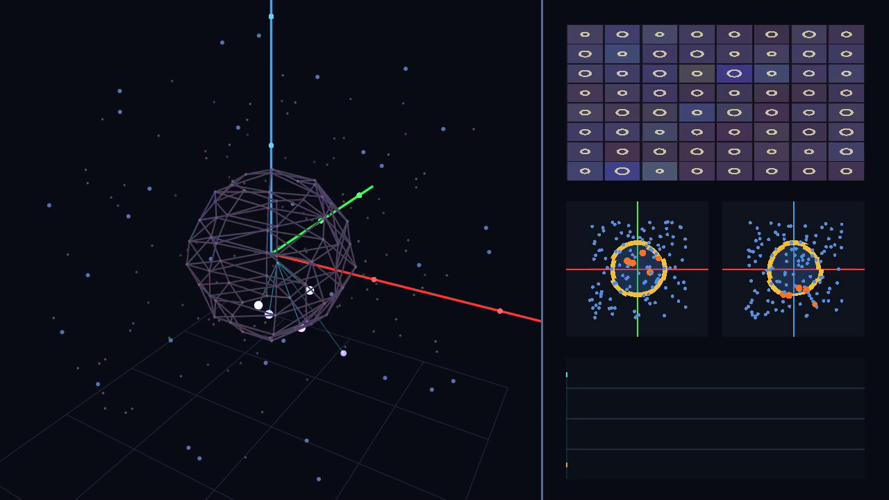
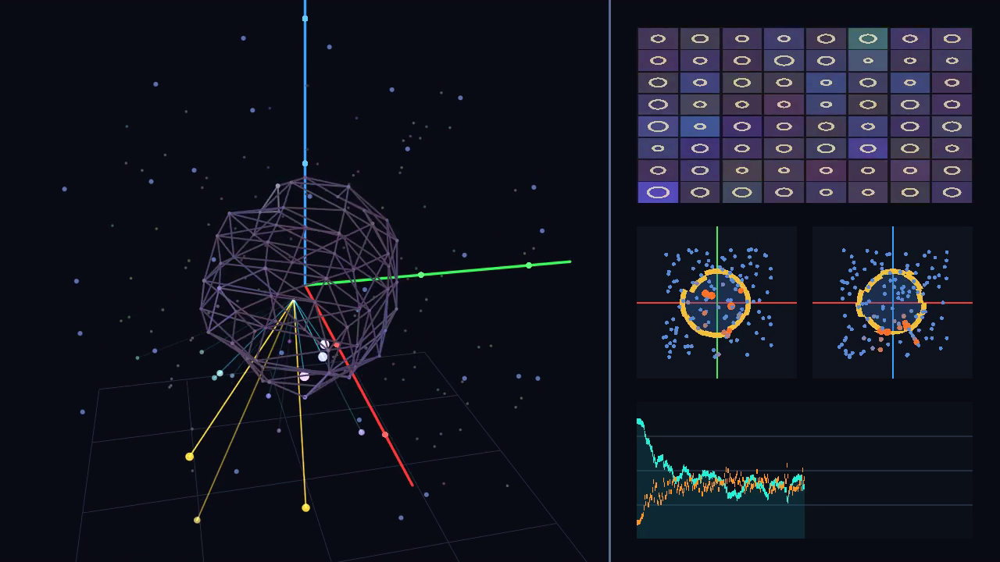
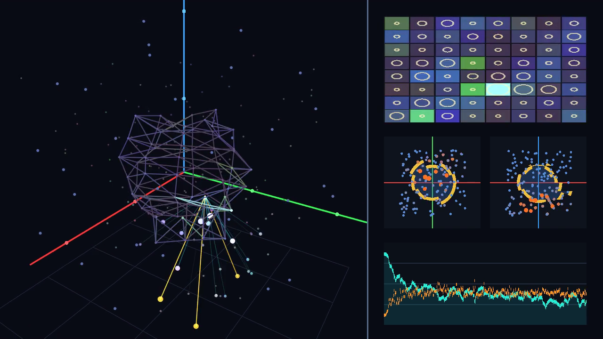

# MarkovMembrane Engine

Решил проверить несколько своих идей о том, можно ли уйти от обычного перемножения плотных матриц и растущего `KV-cache` к вычислениям в 3D-пространстве через 2D-коллизию, перспективу и уровень детализации (LOD).  
Делаю это один с помощью AI-агентов на своём MacBook Pro (Intel Core i9, 16 ГБ RAM, AMD Radeon Pro 5500M 4 ГБ).

---

## Что здесь проверяется

1. **Признак без потери информации и перспектива**:
   - Каждый признак хранит полную структуру векторов (дерево уровней детализации от грубой точки `LOD 0` до мелких граней), а 3D-координаты в комнате задают расстояние и угол.
   - Далёкие объекты считаются грубо (точкой), близкие раскрывают больше векторных граней.
2. **Двумерная мембрана Маркова с рельефом в центре 3D-комнаты $(X, Y, Z)$**:
   - Внутри фигуры — внутреннее состояние модели ($W_{\text{int}}$), которое пытается предсказать внешний сигнал.
   - Снаружи — входящий поток контекста ($W_{\text{ext}}$).
   - От разницы между внутренним ожиданием и внешним вводом ($\varepsilon = W_{\text{ext}} - W_{\text{int}}$) и активной внутренней сложности меняются объём фигуры $V(t)$ и форма её 2D-оболочки: появляются выступы, впадины и неровности ($A \sim V^{2/3}\sqrt{1 + \|\nabla R\|^2}$).
3. **Цвета и яркость (`RGBL`) на полигонах рельефа**:
   - Из встречной интерференции внутренней и внешней волн на полигонах оболочки по локальным правилам считаются 3 цветовых канала (`R`, `G`, `B`) и яркость канала `L` (`float4` на GPU), которым передаётся часть вычислений.
4. **Контекст как внешняя 3D-комната без `KV-cache`**:
   - Вокруг центральной фигуры в комнате находятся внешние узлы памяти для записи фактов и правил перехода (навыков). Обращение к ним идёт лучом только тогда, когда внутреннее состояние не смогло погасить ошибку само.
5. **Упаковка слов (`Субъект — Модулятор — Объект`) и нативный GPU-шейдер (Metal 3)**:
   - Модулятор (действие/глагол) поворачивает 3D-фигуру Субъекта матрицей поворота Родрига $\mathbf{R}_M \in SO(3)$ в сторону Объекта.
   - В версии `v11` убраны PyTorch и побайтовое дробление: код написан на C / Objective-C++ + **Metal 3 (`MSL` шейдеры)** и работает со словами напрямую на видеокарте **AMD Radeon Pro 5500M (4 ГБ)**.

---

## Запись обучения на GPU (`v11`)

Видеофайл (1280×720, 360 кадров, 1440 шагов обучения на словах `WikiText-2` на Radeon Pro 5500M):  
[`iterations/v11_native_metal3_gpu/training_3d_real_gpu_v11.mp4`](iterations/v11_native_metal3_gpu/training_3d_real_gpu_v11.mp4)

* **Слева**: 3D-вид комнаты под углом с осями $X, Y, Z$, полигональной фигурой в центре, узлами в комнате и лучами коллизий.
* **Справа**: 2D-развёртка оболочки в каналах `RGBL`, 2D-проекции по осям `XY` и `XZ` и график ошибки обучения по словам (перплексия слов снижается с `2040,8` до `181,7`).

| Кадр 1 (Начало обучения) | Кадр 180 (Изменение рельефа и запись в комнату) | Кадр 360 (Конец записи) |
|---|---|---|
|  |  |  |

---

## Итерации и ветки (`v0` → `v11`)

Каждая проверка вынесена в отдельную папку `iterations/v*`, ветку (`iter-00-...` — `iter-11-...`) и тег (`v0-...` — `v11-...`).

| Ветка / Тег | Папка | Что проверяли и меняли | Что получилось |
|---|---|---|---|
| `iter-00-probes-gpt2` (`v0`) | [`iterations/v0_probes_gpt2`](iterations/v0_probes_gpt2) | Исходный лог идей и первые тесты 3D-отсечения на готовых весах `GPT-2` и `Qwen2.5-0.5B` + первые тесты на `OpenCL`. | В готовых классических весах энергия размазана по всем осям (топ-3 оси держат 6–9%). Просто отбрасывать дальние связи на чужих весах нельзя — модель нужно сразу учить по этим правилам. |
| `iter-01-energy-conservation` (`v1`) | [`iterations/v1_energy_conservation`](iterations/v1_energy_conservation) | Убрали ручной хардкод `1%` (`topk`). Добавили иерархию групп $S_0\dots S_7$ и закон сохранения плотности поля. | Без сохранения энергии бэкпроп сам раздувал температуру до 80% деталей. С сохранением плотности поля доля активных деталей сама установилась на `1,6%` (`13,9% VRAM`), без потерь при жёстком стриминге (`3,799 BPC`). |
| `iter-02-optics-clod-avalanche` (`v2`) | [`iterations/v2_optics_clod_avalanche`](iterations/v2_optics_clod_avalanche) | Правила оптики (Ламберт, Френель, 2D-проекция), полигональный `CLOD` и каскадная лавина по рёбрам связей. | Синхронная лавина внутри того же шага $t$ размывала фокус (`3,539 BPC`). Перевод лавины во время $t-1 \to t$ (`v2c`) снизил ошибку до `3,478 BPC` (лучше урезанной классики `3,713 BPC` при том же бюджете памяти). |
| `iter-03-lumen-nanite-gpu` (`v3`) | [`iterations/v3_lumen_nanite_gpu`](iterations/v3_lumen_nanite_gpu) | Дерево огрубления полигонов `Nanite DAG` ($8\to 4\to 2\to 1$), трассировка лучей с тенями и кэш освещения по типу `Lumen GI`. | Объём подгрузки в VRAM снизился с `37,4%` до `18,0%` (`6,3%` деталей) при `3,578 BPC`. Шейдер на Radeon Pro 5500M дал скорость `116,9` кадров/с. |
| `iter-04-friston-free-energy` (`v4`) | [`iterations/v4_friston_free_energy`](iterations/v4_friston_free_energy) | Разделение на внутренний мир ($\mu$) и внешнюю среду ($s$) по Карлу Фристону через 2D-границу. | Внутренний мир предсказывает базу через `LOD 0`, а детальные грани открываются от ошибки предсказания. Быстрее старт обучения (`7,660 BPC` на шаге 50), на проверке — `3,404 BPC` при `19,1% VRAM`. |
| `iter-05-pure-local-physics` (`v5`) | [`iterations/v5_pure_local_physics`](iterations/v5_pure_local_physics) | Убрали искусственные костыли (`LayerNorm`, `topk`, фиксированные волны каскада, `Straight-Through`). | Исправили размножение энергии без вычета `overflow` и конфликт шага времени. На `46K` параметрах получили `3,401 BPC` при `6,9%` активных граней (`93,1%` граней = `0.0`). |
| `iter-06-wave-projection-2d` (`v6`) | [`iterations/v6_wave_projection_2d`](iterations/v6_wave_projection_2d) | Проверка градиентов через 2D-экранную проекцию и интерференцию волн вместо матричного бэкпропа. | По операциям в слое вышло в `70–3411` раз меньше FLOPs (`149,6` кадров/с на GPU), но один плоский 2D-экран дал `3,557 BPC` из-за локальности пятна и наложения волн от разных объектов. |
| `iter-07-relief-sphere-3d-room` (`v7`) | [`iterations/v7_relief_sphere_3d_room`](iterations/v7_relief_sphere_3d_room) | Замкнутая фигура в центре 3D-комнаты $(X,Y,Z)$ с рельефом (впадины, выпуклости, изменение площади поверхности). | При тех же `45,8K` параметрах фигура с рельефом (площадь `1,27x`) дала `3,273 BPC` (перплексия `9,67`) против `3,341 BPC` у гладкого шара. |
| `iter-08-holographic-rgbl` (`v8`) | [`iterations/v8_holographic_rgbl`](iterations/v8_holographic_rgbl) | Голографическое соотношение ($A \sim V^{2/3}$ от активной сложности), 3D-полигоны $\mathbf{e}_u \times \mathbf{e}_v$ и 4 канала `RGBL` (цвет + яркость). | На проверке получилось `3,205 BPC` (перплексия `9,22`) при `46,2K` параметрах и `15,7%` открытых граней (у полной классики на `108K` параметрах и 100% матриц — `3,187 BPC`, перплексия `9,11`). |
| `iter-09-exocortex-no-kv` (`v9`) | [`iterations/v9_exocortex_no_kv`](iterations/v9_exocortex_no_kv) | Внешняя память из 32 узлов в 3D-комнате вместо `KV-cache`, чтение по необходимости и порог твёрдости записи. | На `WikiText-2` — `3,206 BPC`. В тесте удержания 5 правил через `10 000` шагов фонового шума при `0 байт KV-cache` с внешней комнатой воспроизведено `100%` правил (без комнаты — `4%`). |
| `iter-10-semantic-packing-svo` (`v10`) | [`iterations/v10_semantic_packing_svo`](iterations/v10_semantic_packing_svo) | Ролевая упаковка `Субъект — Модулятор (3D-поворот Родрига) — Объект` и проверка поворота угла между языками. | На триадах подтвердилось совпадение геометрии между языками после поворота (`98,65%`). На обучении — `3,132 BPC` на шаге 400 (`3,229 BPC` на проверке), но стало видно, что роли нужно вешать на слова, а не на байты. |
| `iter-11-native-metal3-gpu` (`v11`) | [`iterations/v11_native_metal3_gpu`](iterations/v11_native_metal3_gpu) | Отказ от PyTorch и переход от байтов к целым словам: C/ObjC++ движок на **Metal 3** + запись видео обучения с GPU. | Корпус разбирается на `241 066` слов (словарь `2048` слов), обучение и рендер кадра идут на шейдерах Radeon Pro 5500M, перплексия слов за 1440 шагов снижается с `2040,8` до `181,7`. |
