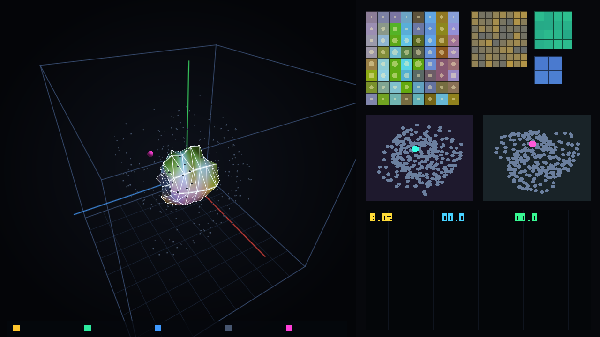
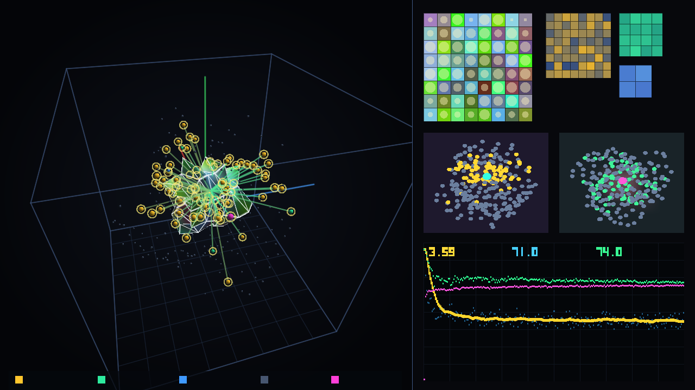
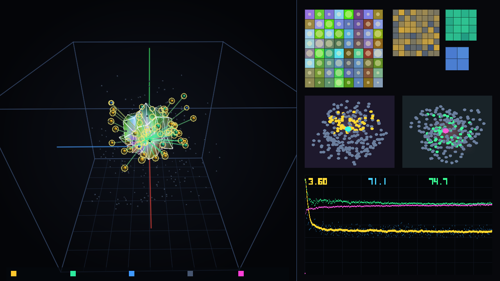

# MarkovMembrane Engine

Репозиторий Андрея Иванченкова для проверки архитектуры вычислений в 3D-пространстве через 2D-коллизию на границе сред, перспективу и уровни детализации (LOD) вместо перемножения плотных матриц и линейно растущего `KV-cache`.  
Все проверки выполнены на MacBook Pro (Intel Core i9-9880H, 16 ГБ RAM, видеокарта `AMD Radeon Pro 5500M` 4 ГБ VRAM).

Полная история изменений по всем версиям (`v0`–`v13`), найденным ошибкам и внесённым исправлениям вынесена в [`CHANGELOG.md`](CHANGELOG.md).  
Все текстовые логи запусков лежат в папке [`logs/`](logs/), а JSON-отчёты проверок и массивы пер-байтовых потерь — в [`audit/`](audit/) и [`review_package/`](review_package/).

> **Примечание об истории коммитов:**  
> Первые 12 версий (`v0`–`v11`) изначально выгружались в репозиторий одним пакетом, поэтому эволюция проекта отражена не в датах первых коммитов, а в коде веток `iter-00`…`iter-13`, истории изменений [`CHANGELOG.md`](CHANGELOG.md), логах [`logs/`](logs/) и JSON-отчётах с фиксированными сидами.

---

## Суть проверяемой архитектуры

1. **2D-граница между внутренним состоянием и внешним контекстом**:
   - Внутри замкнутой 3D-оболочки находится внутреннее состояние модели, которое пытается предсказать следующий шаг.
   - Снаружи поступает сигнал внешнего контекста. Вычисления запускаются от разницы (невязки) между ожиданием и внешним вводом на 2D-поверхности оболочки.
2. **Признак как полный набор чисел (без сжатия в 3 числа)**:
   - Три координаты в 3D-комнате задают только положение объекта, расстояние и угол обзора.
   - Внутри каждого 3D-объекта хранится полный набор из 64 чисел, уложенный по уровням детализации (пирамида Хаара / мип-уровни от грубого среднего до мелких граней).
3. **Уровень детализации (LOD) от близости и остаточной ошибки**:
   - Далёкие объекты представлены одним средним значением всей группы (монополем), средние раскрывают 4 или 16 чисел, и только близкие объекты в фокусе раскрывают все 64 грани.
   - В версии `v13` выбор уровня управляется двусторонним правилом: уровень включается тогда, когда его собственной точности уже достаточно, а родительский уровень давал ошибку выше порога (это исключает двойной счёт родителя и детей).
4. **Отказ от матричных умножений на GPU (`v12` и `v13` на Vulkan API)**:
   - В `v12`–`v13` убраны PyTorch и матричные перемножения (`0 GEMM / 0 matmul`).
   - Поля среды (плотность, температура, направление поля) хранятся в воксельной 3D-текстуре видеокарты и читаются аппаратным текстурным блоком `TMU`, а след контекста записывается прямо в воксели среды вместо хранения растущего `KV-cache`.

---

## Сравнение с классикой и базовыми линиями (на полном проверочном тексте `250 000` байт)

Чтобы не смешивать разные единицы измерения (байты и слова, процессор и видеокарту), результаты разделены по четырём стекам.

### 1. Базовая таблица частот букв `n-gram` без обучаемых параметров (Задача `T2`, `250 352` байта, словарь 256 байт, `OOV = 0`)

| Порядок таблицы частот | Параметров | Проверочных байт | Ошибка (`BPC`, бит на байт) | Перплексия байта |
|---|---:|---:|---:|---:|
| `1-gram` (одиночные байты) | 0 | 250 352 | `4,6048 ± 0,00370` | `24,33` |
| `2-gram` (пары байт) | 0 | 250 352 | `3,5610 ± 0,00381` | `11,80` |
| `3-gram` (тройки байт) | 0 | 250 352 | `3,0154 ± 0,00440` | `8,09` |
| `4-gram` (четвёрки байт) | 0 | 250 352 | `2,5840 ± 0,00516` | `6,00` |
| `5-gram` (пятёрки байт, пол `T2`) | 0 | 250 352 | **`2,3806 ± 0,00594`** | `5,21` |

*Вывод:* простая таблица частот пятёрок букв даёт `2,3806` бита на байт. Все проверенные ниже модели малого масштаба (`46 тысяч` параметров) на текущем бюджете обучения дают `3,30–3,83` бита на байт, то есть пока находятся выше таблицы частот `5-gram`.

---

### 2. Прямое сравнение с классической нейросетью равного размера в PyTorch (Задачи `T1` и `T4`, `249 856` байт, словарь 256 байт, `OOV = 0`)

Обе модели имеют одинаковое число параметров (`46 тысяч`), одинаковую целевую функцию и проверяются на одних и тех же `249 856` байтах (старый обрез проверки до `5 056` байт убран):

| Модель | Параметров | Память состояния | Операций на шаг (`MAC`) | Старый срез `5 056` байт (`BPC`) | Полная проверка `249 856` байт (`BPC`) | `Train EMA(50)` |
|---|---:|---:|---:|---:|---:|---:|
| Классическая модель (`classic_matched`) | `46 472` | `4,0 КБ` | `1 191 936` | `3,3140 ± 0,0321` | **`3,3387 ± 0,00464`** | `3,2460` |
| Мембранная модель `v8` (рельеф + `RGBL` + каскад) | `46 179` | `388,0 КБ` | `13 680 640` (без усечения дерева) | `3,2693 ± 0,0324` | **`3,2966 ± 0,00466`** | `3,2220` |
| Разница (`v8` минус классика) | `-293` (`-0,63%`) | — | — | `-0,0447` (в пределах шума среза) | **`-0,0421 ± 0,00176`** (`v8` точнее) | `-0,0240` |

---

### 3. Безматричный 3D-движок на Vulkan API (`v12` и `v13`, видеокарта `AMD Radeon Pro 5500M`, `250 240` байт, `0` матричных умножений)

| Версия и режим на Vulkan GPU | Матричных умножений | Чтение из VRAM (`байт/шаг`) | Экономия чтения VRAM | Отсечено объектов (`Culling`) | Полная проверка `250 240` байт (`BPC`) | Скорость на GPU |
|---|---:|---:|---:|---:|---:|---:|
| **`v13` (двусторонний срез Хаара + учёт деформации, 2400 шагов)** | **0** | **`16 536,7`** | **`74,77%` (`3,96×` меньше)** | `71,49%` | **`3,6560 ± 0,00432`** (`EMA50 = 3,574`) | `273,1` шага/с (`21,3` кадра/с) |
| `v12` (отбор мип-уровней по расстоянию, 2400 шагов) | **0** | **`8 291,5`** | **`87,35%` (`7,90×` меньше)** | `71,46%` | **`3,8273 ± 0,00500`** (`EMA50 = 3,894`) | `638,0` шагов/с (`36,0` кадров/с) |
| `v12` (среднее по 5 сидам `1..5`, 800 шагов) | **0** | `6 951,1` | **`89,39%` (`9,43×` меньше)** | `77,80%` | `3,9896 ± 0,0410` | `490,1` шага/с |
| `v12 Dense LOD 0` (контроль без отсечения и без мип-уровней) | **0** | `65 536,0` | `0,00%` (`1,00×`) | `0,00%` | `3,7460 ± 0,00490` | `311,3` шага/с |
| `v12` с выключенным законом сохранения поля (тест `a4`) | **0** | `7 341,0` | `88,80%` | `70,59%` | `6,4939 ± 0,01320` (расходится) | `778,1` шага/с |

---

### 4. Словесный движок `v11` на Metal 3 (`vocab = 2048` слов, замечание `A5`)

- В обучающем корпусе `WikiText-2` (`241 067` слов, `21 864` уникальных слова) словарь из `2048` самых частых слов покрывает `76,34%` текста, а остальные **`23,66%` слов (`57 026` вхождений)** заменяются на общий токен `<unk>`.
- Из-за слияния редких слов в `<unk>` словесная ошибка `7,505` бит на слово (перплексия слов `181,7`) не сопоставима напрямую с побайтовыми моделями (`OOV = 0`).

---

## Что подтверждено замерами, а что дало отрицательный результат

### Подтверждено и работает:
1. **Постоянный размер памяти состояния вместо линейно растущего `KV-cache`**:
   - В `v8` состояние занимает фиксированные `388 КБ`, а в `v12`–`v13` на Vulkan воксельная 3D-текстура среды и волокна потока занимают `9 КБ` независимо от длины текста:
   - На длине контекста `T = 64` выигрыш к `KV-cache` составляет `1,32×` (`388 КБ` против `512 КБ`), на `T = 256` — `5,28×` (`2 048 КБ`), на `T = 1024` — **`21,1×`** (`8 192 КБ`), на `T = 4096` — **`84,5×`** (`32 768 КБ`).
2. **Реальное сокращение чтений памяти и операций после включения двустороннего среза (`N1`–`N7`)**:
   - На всех `24 033 792` проверках узлов зафиксировано `0` нарушений монотонности ошибки, и у `100%` узлов включается ровно один уровень детализации.
   - По калибровочной кривой [`review_package/tau_sweep_curve_N3.csv`](review_package/tau_sweep_curve_N3.csv) при пороге `0,15` потеря точности равна `0,00009` бита (меньше погрешности `SE = 0,00384`), при пороге `0,35` средняя глубина падает до `14,4` из `64` (сокращение счёта и чтений памяти **в `4,4` раза**), а на Vulkan в `v12`–`v13` чтение видеопамяти реально снижено **на `74,8%–89,4%`**.
   - Переход на список реальных соседей в каскаде коллизий (`N7`, пересекаются только `9,67%` пар объектов) сокращает счёт каскада **в `10,39` раза** (`42 576` операций вместо `442 368`) при нулевом расхождении ответа (`0,000000`).
3. **Учёт деформации мембраны (`N13`) и поддержка `Metal VRR` на Radeon (`N8`)**:
   - Отслеживание текущего изгиба оболочки при выборе среза (`tracked`) держит `100%` гарантию порога ошибки и экономит `18,8%` операций по сравнению с фиксированным запасом на худший изгиб (`worst_case`).
   - Прямой вызов API `supportsRasterizationRateMapWithLayerCount(1)` на `AMD Radeon Pro 5500M` подтвердил аппаратную поддержку `Metal VRR`: физический буфер сжимается с `512×512` до `352×352`, экономя **`52,73%`** вызовов фрагментного шейдера и видеопамяти.
4. **Побитовая повторяемость на Radeon**: два прогона подряд на `AMD Radeon Pro 5500M` дают побитово идентичный результат (`bit_identical = true`, `max_abs_diff = 0`).

### Отрицательные результаты и ограничения (зафиксированы в `negative_results`):
1. **Выбор узлов пока уступает полной оценке силы сигнала (`T9` / `N10`)**:
   - После перевода энергии в базис Хаара ранговая корреляция Спирмена между выбранной глубиной узла и его реальной важностью выросла с `0,033` до **`0,481`** (при случайном угадывании `0,000`), но остаётся ниже прямой эвристики по полной норме произведения (`0,622`). Поэтому выбор уровня детализации по геометрии пока не заменяет полный ранжирующий оракул.
2. **Интерференция в фиксированных узлах памяти при росте числа фактов (`T13`)**:
   - В буфере из 32 узлов (`8 КБ`) точность извлечения составляет `100,0%` на `5` правилах, но при записи `50` правил снижается до `52,0%`, а при `500` правилах — до `8,4%`.
3. **Условная взаимная информация на границе (`T14`)**:
   - Отношение условной взаимной информации к безусловной составляет `0,8422` (не близко к нулю), поэтому 2D-оболочка является рабочим интерфейсом обмена между внутренним и внешним состоянием, а не строгим марковским одеялом.
4. **Межъязыковой поворот Прокруста на малом словаре (`A9`)**:
   - На обучающих триадах косинус совпадения равен `0,8449`, но на новых (held-out) словах при размерности 64 и 40 опорных парах падает до `0,0141`.

---

## Видео и кадры 2D-проекции 3D-комнаты с перспективы всех шагов обучения

1. **Версия `v13` (Vulkan GPU, двусторонний срез пирамиды Хаара + учёт деформации рельефа)**:  
   Видео (480 кадров, 2400 шагов): [`iterations/v13_vulkan_nanite_cut_lod/training_vulkan_nanite_cut_v13.mp4`](iterations/v13_vulkan_nanite_cut_lod/training_vulkan_nanite_cut_v13.mp4)

| Кадр 1 (`v13`, старт обучения) | Кадр 240 (`v13`, середина обучения) | Кадр 480 (`v13`, финал: `EMA50 = 3,57`, `Val BPC = 3,66`) |
|---|---|---|
|  |  |  |

2. **Версия `v12` (Vulkan GPU, безматричный 3D-движок с отбором мип-уровней по расстоянию)**:  
   Видео (480 кадров, 2400 шагов): [`iterations/v12_vulkan_matrix_free_3d/training_vulkan_3d_room_v12.mp4`](iterations/v12_vulkan_matrix_free_3d/training_vulkan_3d_room_v12.mp4)

| Кадр 1 (`v12`, старт обучения) | Кадр 240 (`v12`, середина обучения) | Кадр 480 (`v12`, финал: `Val BPC = 3,83`) |
|---|---|---|
|  |  |  |

3. **Версия `v11` (Metal 3 GPU, обучение на уровне слов `vocab = 2048`)**:  
   Видео (360 кадров, 1440 шагов): [`iterations/v11_native_metal3_gpu/training_3d_real_gpu_v11.mp4`](iterations/v11_native_metal3_gpu/training_3d_real_gpu_v11.mp4)

---

## Таблица всех версий, веток и тегов (`v0` → `v13`)

| Версия | Ветка / Тег | Папка | Что добавлено и исправлено | Результат проверки |
|---|---|---|---|---|
| `v0` | `iter-00-probes-gpt2` (`v0-probes-gpt2`) | [`iterations/v0_probes_gpt2`](iterations/v0_probes_gpt2) | Первые тесты отсечения дальних связей на готовых весах `GPT-2` и `Qwen2.5-0.5B`. | В готовых весах энергия размазана равномерно (топ-3 оси держат 6–9%). Выбрасывать дальние столбцы без обучения в 3D-среде нельзя. |
| `v1` | `iter-01-energy-conservation` (`v1-energy-conservation`) | [`iterations/v1_energy_conservation`](iterations/v1_energy_conservation) | Убран хардкод `1%`, введены 8 групп детализации внутри признака и закон сохранения плотности поля. | Закон сохранения удерживает долю открытых деталей на `1,6%` (`3,799 BPC` на срезе). Без сохранения детали раздуваются до `79,9%`. |
| `v2` | `iter-02-optics-clod-avalanche` (`v2-optics-clod-avalanche`) | [`iterations/v2_optics_clod_avalanche`](iterations/v2_optics_clod_avalanche) | Учёт телесного угла, угла падения и перенос каскада во времени $t-1 \to t$ (`v2c`). | Синхронный каскад внутри шага размывает фокус (`3,539 BPC`); перенос во времени $t-1 \to t$ снижает ошибку на срезе до `3,478 BPC`. |
| `v3` | `iter-03-lumen-nanite-gpu` (`v3-lumen-nanite-gpu`) | [`iterations/v3_lumen_nanite_gpu`](iterations/v3_lumen_nanite_gpu) | Ортогональный базис Хаара ($8\to 4\to 2\to 1$) и первый шейдер на OpenCL для Radeon. | На срезе `3,578 BPC`; скорость рендера шейдера на Radeon Pro 5500M — `116,9` кадров/с. |
| `v4` | `iter-04-friston-free-energy` (`v4-friston-free-energy`) | [`iterations/v4_friston_free_energy`](iterations/v4_friston_free_energy) | Разделение на внутренний прогноз и внешний сигнал через 2D-границу + вспомогательный MSE. | Ошибка на срезе снизилась до `3,404 BPC`. |
| `v5` | `iter-05-pure-local-physics` (`v5-pure-local-physics`) | [`iterations/v5_pure_local_physics`](iterations/v5_pure_local_physics) | Убран `Straight-Through`, введён мягкий гейт Михаэлиса–Ментен и вычет поглощённой энергии в каскаде. | На `46 054` параметрах ошибка на срезе `3,401 BPC` при `6,9%` координат с ненулевым гейтом. |
| `v6` | `iter-06-wave-projection-2d` (`v6-wave-projection-2d`) | [`iterations/v6_wave_projection_2d`](iterations/v6_wave_projection_2d) | Проекция объектов в локальное пятно $3\times 3$ на плоском 2D-экране (`149,6` кадров/с на GPU). | Из-за локальности пятна и наложения волн соседних объектов (косинус с градиентом `0,0875`) ошибка ухудшилась до `3,557 BPC`. |
| `v7` | `iter-07-relief-sphere-3d-room` (`v7-relief-sphere-3d-room`) | [`iterations/v7_relief_sphere_3d_room`](iterations/v7_relief_sphere_3d_room) | Замкнутая сферическая оболочка с деформируемым рельефом в центре 3D-комнаты. | На срезе `3,273 BPC` против `3,341 BPC` у гладкого шара. |
| `v8` | `iter-08-holographic-rgbl` (`v8-holographic-rgbl`) | [`iterations/v8_holographic_rgbl`](iterations/v8_holographic_rgbl) | 3D-полигоны через векторное произведение рёбер, масштаб площади от объёма и 4 канала `RGBL`. | На полной валидации `249 856` байт (`T1`): **`3,2966 ± 0,00466 BPC`** (выигрывает у выровненной классики `46K` с `3,3387 BPC`). |
| `v9` | `iter-09-exocortex-no-kv` (`v9-exocortex-no-kv`) | [`iterations/v9_exocortex_no_kv`](iterations/v9_exocortex_no_kv) | 32 внешних узла памяти в 3D-комнате (`8 КБ`) вместо `KV-cache`. | Помнит `100%` из 5 правил через `10 000` шагов шума; при 50/500 правилах точность падает до `52,0%` / `8,4%` (`T13`). |
| `v10` | `iter-10-semantic-packing-svo` (`v10-semantic-packing-svo`) | [`iterations/v10_semantic_packing_svo`](iterations/v10_semantic_packing_svo) | Ролевая упаковка «Субъект — Модулятор (3D-поворот Родрига) — Объект». | На побайтовом входе `3,229 BPC` на срезе; показана необходимость перехода от букв к словам. |
| `v11` | `iter-11-native-metal3-gpu` (`v11-native-metal3-gpu`) | [`iterations/v11_native_metal3_gpu`](iterations/v11_native_metal3_gpu) | Движок на C/ObjC++ и шейдерах Metal 3 на уровне целых слов (`vocab = 2048`). | Перплексия слов `181,7` (`7,505` бит/слово), но `23,66%` редких слов уходят в `<unk>` (`A5`). |
| `v12` | `iter-12-vulkan-matrix-free-3d` (`v12-vulkan-matrix-free-3d`) | [`iterations/v12_vulkan_matrix_free_3d`](iterations/v12_vulkan_matrix_free_3d) | Полностью безматричный 3D-движок на Vulkan (`0 GEMM`), 3D-текстура среды `TMU`, `Spatial Culling`, `Mip-LOD`. | Полная валидация `250 240` байт: **`3,8273 ± 0,00500 BPC`**, реальная экономия чтения VRAM **`87,35%–89,39%`**, `638` шагов/с. |
| **`v13`** | `iter-13-nanite-cut-deformable-lod` (`v13-nanite-cut-deformable-lod`) | [`iterations/v13_vulkan_nanite_cut_lod`](iterations/v13_vulkan_nanite_cut_lod) | Двустороннее правило среза пирамиды Хаара (`N1`–`N7`), монополь дальнего поля, учёт деформации (`N13`), проверка `Metal VRR` (`N8`). | Полная валидация `250 240` байт на Vulkan: **`3,6560 ± 0,00432 BPC`** (`EMA50 = 3,574`), экономия чтения VRAM **`74,77%`**, `0` нарушений монотонности, корреляция с оракулом выросла до **`0,481`**. |

---

## Опубликованные логи и отчёты в репозитории

### Текстовые логи прогонов ([`logs/`](logs/)):
- [`logs/audit_T1_T2_T4_A5.log`](logs/audit_T1_T2_T4_A5.log) — лог проверки фактов кода `v8`, расчёта таблиц `n-gram 1..5` (`T2`), полной валидации `249 856` байт (`T1`), классического контроля `46K` (`T4`) и аудита словаря `v11` (`A5`).
- [`logs/vulkan_v12_matrix_free_train_and_val.log`](logs/vulkan_v12_matrix_free_train_and_val.log) — лог обучения (2400 шагов) и полной валидации (`250 240` байт) безматричного движка `v12` на Vulkan GPU.
- [`logs/vulkan_audit_suite_5seeds_ablations.log`](logs/vulkan_audit_suite_5seeds_ablations.log) — лог проверки побитовой детерминированности на Radeon, 5 сидов (`T3`), матрицы стриминга (`T5`), экономии памяти (`T6`+`T8`), изменчивости маски (`T10`) и аблаций (`T12`) на Vulkan GPU.
- [`logs/vulkan_v13_nanite_cut_train_and_val.log`](logs/vulkan_v13_nanite_cut_train_and_val.log) — лог обучения и полной валидации `v13` с двусторонним срезом Хаара и отслеживанием деформации на Vulkan GPU.
- [`logs/task2_N1_to_N14_run.log`](logs/task2_N1_to_N14_run.log) — полный лог прогона всех задач `N1`–`N14` (свип порога `tau*`, проверка 0 нарушений монотонности, единственность уровня среза, `a9`, `a10`, `N10`, `N11`, `N13`).
- [`logs/metal_vrr_N8_check.log`](logs/metal_vrr_N8_check.log) — лог аппаратной проверки `Metal VRR` (`supportsRasterizationRateMapWithLayerCount`) на `AMD Radeon Pro 5500M`.

### Структурированные JSON-отчёты и таблицы ([`audit/`](audit/) и [`review_package/`](review_package/)):
- [`audit/report_T1_T2_T4.json`](audit/report_T1_T2_T4.json)
- [`audit/report_vulkan_matrix_free_suite.json`](audit/report_vulkan_matrix_free_suite.json)
- [`audit/report_T9_T13_T14_T15_falsification.json`](audit/report_T9_T13_T14_T15_falsification.json)
- [`review_package/report_task2_schema_sec6.json`](review_package/report_task2_schema_sec6.json)
- [`review_package/tau_sweep_curve_N3.csv`](review_package/tau_sweep_curve_N3.csv)
- [`review_package/metal_vrr_n8_result.json`](review_package/metal_vrr_n8_result.json)
- [`review_package/hill_n_and_alpha_distributions.json`](review_package/hill_n_and_alpha_distributions.json)
- [`review_package/tables_N10_N11_N12_N13.json`](review_package/tables_N10_N11_N12_N13.json)
