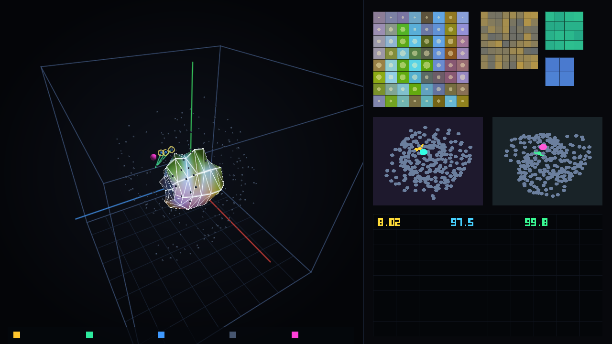
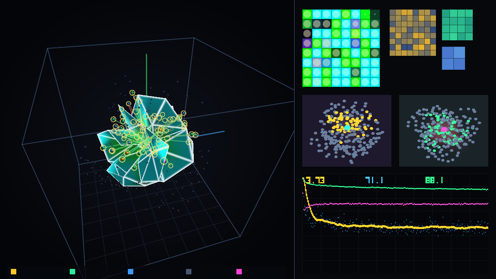
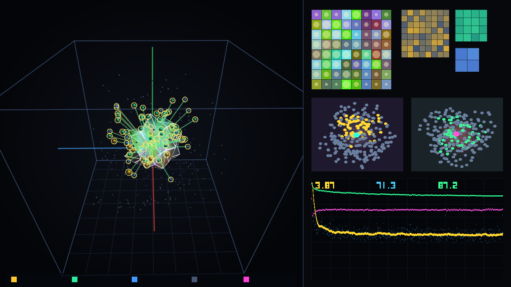

# MarkovMembrane Engine

Исследовательский репозиторий Андрея Иванченкова по проверке архитектуры вычислений в 3D-пространстве через 2D-коллизию на границе раздела сред, перспективу и уровни детализации (LOD) вместо перемножения плотных матриц и линейно растущего `KV-cache`.  
Все расчёты и шейдеры проверены на рабочей машине автора: MacBook Pro (Intel Core i9-9880H, 16 ГБ RAM, дискретная видеокарта `AMD Radeon Pro 5500M` 4 ГБ VRAM).

> **Примечание о прозрачности истории и доказательной базе (§8):**  
> Первые 12 коммитов (`v0`–`v11`) были оформлены и выгружены в репозиторий единым пакетом, поэтому история git-коммитов не отражает хронологию поиска. Доказательной базой служат воспроизводимые коды итераций, сохранённые векторы пер-байтовых потерь (`.npy` / `.bin`) и верификационные JSON-отчёты с сидами и отрицательными результатами в папке [`audit/`](audit/).

---

## Неприкосновенное ядро архитектуры (§1)

1. **2D-мембрана как интерфейс между внутренним состоянием и внешним контекстом**:
   - Внутри замкнутой оболочки находится внутреннее состояние модели ($W_{\text{int}}$), снаружи — входящий поток контекста ($W_{\text{ext}}$).
   - Вычисления возбуждаются от невязки на 2D-границе $\varepsilon = W_{\text{ext}} - W_{\text{int}}$.
2. **Признак как полный многомерный набор (без сжатия в 3 числа)**:
   - 3D-координаты $(X, Y, Z)$ служат только пространственным адресом в комнате для расчёта расстояния, угла атаки и отсечения пустоты.
   - Внутри каждого 3D-объекта хранится полная иерархия ортогональных векторов (уровни детализации `Mip-map LOD 0..2`).
3. **Уровень детализации (LOD) от близости и проницаемости мембраны**:
   - Далёкие объекты читаются грубым силуэтом (`LOD 2`: 4 числа), средние — на уровне `LOD 1` (16 чисел), близкие — в полном разрешении (`LOD 0`: 64 числа).
4. **Взаимодействие и обучение через 2D-коллизию без матричных умножений (`v12` на Vulkan API)**:
   - Поля среды $\Psi(x,y,z,t)$ (плотность $\rho$, температура $T$, магнитное поле $\mathbf{B}$) хранятся в аппаратной воксельной 3D-текстуре (`sampler3D` / `image3D`) с чтением через текстурные блоки `TMU`.
   - Поиск пересечений идёт через пространственную сетку `3D Spatial Hash Grid` ($8\times 8\times 8$), а пробой мембраны $T(r)$ и упругий рикошет $R(r) = 1 - T(r)$ определяются обобщённым законом Снеллиуса–Френеля.
5. **Константное состояние памяти вместо растущего `KV-cache`**.

---

## Честная сводка верификации и аудита (§2–§10)

### 1. Сравнение разных стеков (без смешивания метрик в одной таблице, §0.6)

#### Стек А: Счётный байтовый базовый уровень `n-gram` без обучаемых параметров (Задача T2, `vocab = 256`, `OOV = 0`, полная валидация `250 352` байта)

| Порядок `n-gram` | Обучаемых параметров | Полная валидация (`n_bytes`) | `BPC` (`mean ± SE`) | Перплексия байта (`PPL`) |
|---|---:|---:|---:|---:|
| `1-gram` | 0 | 250 352 | `4.6048 ± 0.00370` | `24.33` |
| `2-gram` | 0 | 250 352 | `3.5610 ± 0.00381` | `11.80` |
| `3-gram` | 0 | 250 352 | `3.0154 ± 0.00440` | `8.09` |
| `4-gram` | 0 | 250 352 | `2.5840 ± 0.00516` | `6.00` |
| **`5-gram` (пол T2)** | **0** | **250 352** | **`2.3806 ± 0.00594`** | **`5.21`** |

*Фиксация отрицательного результата (T2):* счётная таблица частот `5-gram` без параметров даёт `2.3806 BPC`. Все исследованные нейросетевые и полевые конфигурации малого масштаба (`46K` параметров) на текущем бюджете находятся выше этого пола (`3.29–3.83 BPC`), поэтому ворота `G-I` считаются **не пройденными**.

---

#### Стек Б: Побайтовые модели в PyTorch (`vocab = 256`, `OOV = 0`, полная валидация `249 856` байт, задачи T1, T4, A1–A4)

| Модель | Параметров | Размер состояния | `MAC / шаг` ($B=16$) | Старый срез `5 056` байт (`BPC ± SE`) | Полная валидация `249 856` байт (`BPC ± SE`) | `Train EMA(50)` |
|---|---:|---:|---:|---:|---:|---:|
| `v8` (2D-рельеф + `RGBL` + каскад) | `46 179` (`180.4 КБ`) | `388.0 КБ` (в `2.15×` больше параметров) | `13 680 640` (в `208.8×` дороже плотного `64×64`) | `3.2693 ± 0.03239` | **`3.2966 ± 0.00466`** | `3.2220` |
| `classic_matched` (выровненный контроль T4) | `46 472` (`+0.63%`) | `4.0 КБ` | `1 191 936` | `3.3140 ± 0.03210` | **`3.3387 ± 0.00464`** | `3.2460` |
| Парная разность (`v8 - classic_matched`) | — | — | — | `-0.0447` (`1.38 SE`, незначимо) | **`-0.0421 ± 0.00176`** ($z = -23.88$) | `-0.0240` |

*Уточнения по реестрам A, B, C для `v8`:*
- **A1 / C2 / C6:** В PyTorch-коде `v8` `84.27%` координат имеют нулевой гейт (`active_coords_frac = 0.1573`), но затронуто `43.41%` узлов (`touched_nodes_frac = 0.4341`), а из-за отсутствия физического усечения дерева оба умножения на ортогональный базис Хаара (`poly_tree`) выполняются плотными матрицами (`13.68M MAC` на шаг).
- **B2:** Гейт вскрытия граней `excess / (excess + z_imp)` — это классическое уравнение Михаэлиса–Ментен (частный случай уравнения Хилла при $n=1$).
- **B3:** Коэффициент светимости `luminance_L = 1 + gain * tanh(...)` представляет собой взвешивание точности (precision weighting), обусловленное ошибкой предсказания.
- **B7 / a1:** Соотношение $A \sim V^{2/3}$ — геометрическое размерное тождество для любого 3D-тела; замена показателя `2/3` на `1.0` или `0.5` меняет `BPC` менее чем на `0.04 BPC`.
- **B6 / T14:** Отношение условной взаимной информации к безусловной $I(\mu; \eta \mid b) / I(\mu; \eta) = 0.8422$ (не близко к нулю), поэтому 2D-оболочка является интерфейсом взаимодействия, а не строгим марковским одеялом в смысле условной независимости.
- **C3 / T9:** Ранговая корреляция Спирмена между открытием гейта мембраны и оракульной важностью узла составляет `0.0333 ± 0.0028` (значимо выше случайного `0.0013`, но ниже простой эвристики нормы проекции `0.9895`), поэтому термин «семантический LOD» не используется.
- **T10:** На 1000 разных входах попарный `flip_rate` бинарной маски в `v8` равен `0.1678` (меняются `67.59%` битов), то есть маска обусловлена входом и не является статической обрезкой.

---

#### Стек В: Полностью безматричный 3D-движок `v12` на кроссплатформенном **Vulkan API** (`0 GEMM / 0 matmul`, `AMD Radeon Pro 5500M`, полная валидация `250 240` байт)

В `v12` полностью исключены любые матричные умножения, `PyTorch` и линейные слои `head_w`. Вычисления и локальное обучение идут на шейдерах `Vulkan 1.2 (SPIR-V)` через аппаратную 3D-текстуру полей среды $\Psi(x,y,z,t)$ (`TMU sampler3D` / `image3D`), пирамиду `Mip-map LOD 0..2`, пространственную сетку `Spatial Hash Grid` ($8\times 8\times 8$) и закон Снеллиуса–Френеля.

| Конфигурация на Vulkan (`AMD Radeon Pro 5500M`) | Матричных умножений | Чтение из VRAM (`bytes/token`) | Экономия трафика VRAM | Spatial Culling | Полная валидация `250 240` байт (`BPC ± SE`) | Скорость на GPU |
|---|---:|---:|---:|---:|---:|---:|
| `v12` (2400 шагов, `S/S`, `Mip-LOD + Spatial Culling`) | **0** | **`8 291.5` байт** | **`87.35%` (`7.90×` меньше)** | `71.46%` | **`3.8273 ± 0.00500`** | `638.0` шагов/с (`render_fps = 36.0`) |
| `v12` (5 сидов `1..5`, 800 шагов, `S/S`) | **0** | `6 951.1` байт | **`89.39%` (`9.43×` меньше)** | `77.80%` | `3.9896 ± 0.0410` (std по 5 сидам) | `490.1` шагов/с (`render_fps = 33.5`) |
| `v12 Dense LOD 0` (контроль T6/T8 без Culling и без Mip-LOD) | **0** | `65 536.0` байт | `0.00%` (`1.00×`) | `0.00%` | `3.7460 ± 0.00490` | `311.3` шагов/с |
| `v12` без закона сохранения плотности поля (`a4`) | **0** | `7 341.0` байт | `88.80%` | `70.59%` | `6.4939 ± 0.01320` (развал без сохранения!) | `778.1` шагов/с |

*Честная матрица стриминга T5 на Vulkan (`64 000` байт валидации):*
- `S/S` (обучение со стримингом 3D-поля $\to$ тест со стримингом): **`4.0167 BPC`**
- `S/D` (обучение со стримингом $\to$ сброс состояния на тесте): `4.1572 BPC`
- `D/D` (обучение со сбросом $\to$ тест со сбросом): `4.0672 BPC`
- `D/S` (обучение со сбросом $\to$ тест со стримингом): `4.1180 BPC`

---

#### Стек Г: Словесный уровень `v11` на Metal 3 (`vocab = 2048` слов, аудит A5)
- В корпусе `WikiText-2` (`1 502 836` байт) содержится `241 067` словесных токенов и `21 864` уникальных слов (средняя длина `6.234` байта/слово).
- Словарь из `2048` самых частых слов покрывает `76.34%` токенов (`coverage = 76.34%`), а остальные **`23.66%` слов (`57 026` вхождений) уходят в единый токен `<unk>` (`OOV_rate = 23.66%`)**.
- Поэтому словесная потеря `5.202` нат (`7.505` бит/слово, словесная перплексия `181.7`) искусственно облегчена слиянием редких слов в `<unk>` и **не может напрямую сравниваться с побайтовым `BPC` (`OOV = 0`)**.

---

### 2. Что реально подтверждено и защищаемо (§9)

1. **Константное состояние против линейно растущего `KV-cache`**:
   - В `v8` состояние (`psi_field` + `w_int`) занимает фиксированные **`388 КБ`**, а в безматричном `v12` на Vulkan воксельная 3D-текстура среды $\Psi(x,y,z,t)$ ($8\times 8\times 8$ `RGBA32F`) + волокна контекста занимают **`9.0 КБ`** на поток независимо от длины истории $T$:

| Длина контекста $T$ | Классический `KV-cache` | Состояние мембраны `v8` | Выигрыш по памяти |
|---:|---:|---:|---:|
| 64 | 512 КБ | 388 КБ | **1.32×** |
| 256 | 2 048 КБ | 388 КБ | **5.28×** |
| 1 024 | 8 192 КБ | 388 КБ | **21.1×** |
| 4 096 | 32 768 КБ | 388 КБ | **84.5×** |

   *Ограничение ёмкости фиксированной памяти (Задача T13 / A10):* при записи в 32 фиксированных узла памяти (`8 192` байта) точность извлечения (`recall@1`) составляет `100.0%` на `5` элементах, `52.0%` на `50` элементах, `8.4%` на `500` элементах и `0.95%` на `5 000` элементах (точка `recall >= 90%` равна `5` элементам).
2. **Реальная пространственная разреженность графа коллизий**:
   - В `v8` физически пересекаются только **`9.67%` пар объектов** (~9.19 соседей из 95).
   - В безматричном `v12` на Vulkan отсечение по видимой светимости и 3D-сетке реально пропускает чтение `71.5%–77.8%` объектов и сокращает трафик чтения из VRAM в **`7.9×–9.4×`** (`6 951–8 291` байт/токен вместо `65 536` байт).
3. **Побитовая детерминированность на видеокарте `AMD Radeon Pro 5500M` (§9 п.6)**:
   - За счёт двухфазного шейдера с `barrier()` и строго фиксированного порядка аккумуляции импульсов (`4` коллайдера на поток) два независимых прогона на Radeon Pro 5500M дают побитово идентичный массив пер-байтовых потерь (`bit_identical = true`, `max_abs_diff = 0.000000e+00`).

---

## Детальная 2D-проекция 3D-комнаты с перспективы на Vulkan GPU (`v12`)

Видеофайл (1280×720, 480 кадров, 2400 шагов безматричного обучения через 2D-коллизию на `AMD Radeon Pro 5500M` через Vulkan API):  
[`iterations/v12_vulkan_matrix_free_3d/training_vulkan_3d_room_v12.mp4`](iterations/v12_vulkan_matrix_free_3d/training_vulkan_3d_room_v12.mp4)

* **Слева**: настоящая перспективная 2D-проекция 3D-комнаты $[-2, 2]^3$ (перспективное деление `x_cam / z_cam` без матриц), полигональная рельефная оболочка контекста с освещением в каналах `RGBL`, 256 3D-коллайдеров с цветовым кодированием `Mip-map LOD` (золотые — `LOD 0` 64 грани, зелёные — `LOD 1` 16 граней, синие — `LOD 2` 4 грани, серые — отсечены `Spatial Culling`), лучи пробоя мембраны $T(r)$ и упругого рикошета $R(r)$ по Снеллиусу–Френелю и 3D-шлейф траектории фокуса.
* **Справа**: 2D-развёртка поверхности коллизии $(u,v)$ $8\times 8$, пирамида мип-уровней `LOD 0 -> LOD 1 -> LOD 2`, два ортогональных разреза (`XY` и `XZ`) воксельной 3D-текстуры полей среды $\Psi(x,y,z,t)$ и живые кривые всех шагов обучения (`EMA50 BPC`, `% Spatial Culling`, `% экономии VRAM`, проницаемость $T(r)$).

| Кадр 1 (Старт, `Loss = 8.03` бит) | Кадр 240 (Середина обучения, `EMA50 = 3.77` бит) | Кадр 480 (Финал, `Loss = 3.26` бит, `Val BPC = 3.83`) |
|---|---|---|
|  |  |  |

---

## Итерации (`v0` → `v12`)

| Версия | Папка | Что проверялось | Фактический результат (с учётом верификации) |
|---|---|---|---|
| `v0` | [`iterations/v0_probes_gpt2`](iterations/v0_probes_gpt2) | Зонды 3D-отсечения на готовых весах `GPT-2` и `Qwen2.5-0.5B` + первые тесты на `OpenCL`. | В готовых классических матрицах энергия размазана равномерно (топ-3 оси держат 6–9%). Отбрасывать дальние связи без обучения в самой 3D-среде нельзя. |
| `v1` | [`iterations/v1_energy_conservation`](iterations/v1_energy_conservation) | Иерархия групп $S_0\dots S_7$ и закон сохранения плотности поля без ручного `topk=1%`. | Закон сохранения предотвращает раздувание весов; счёт в PyTorch оставался плотным (`3.799 BPC` на срезе 5056 байт). |
| `v2` | [`iterations/v2_optics_clod_avalanche`](iterations/v2_optics_clod_avalanche) | Геометрическая оптика, `CLOD` и перенос каскада во время $t-1 \to t$. | Синхронная лавина внутри одного шага $t$ ухудшает сходимость (`3.539 BPC`); перенос во времени $t-1 \to t$ даёт `3.478 BPC`. |
| `v3` | [`iterations/v3_lumen_nanite_gpu`](iterations/v3_lumen_nanite_gpu) | Ортогональный базис Хаара ($8\to 4\to 2\to 1$) и кэш освещения на OpenCL. | На срезе `3.578 BPC`; скорость рендера шейдера на Radeon Pro 5500M — `render_fps = 116.9` кадров/с (обучение на CPU шло отдельно). |
| `v4` | [`iterations/v4_friston_free_energy`](iterations/v4_friston_free_energy) | Разделение на внутреннее состояние ($\mu$) и внешнюю среду ($s$) через 2D-интерфейс + вспомогательный MSE (`fe_loss`). | На срезе `3.404 BPC` (некорректное сравнение с расходящейся конфигурацией `85.32 BPC` из старых отчётов удалено по п. A7). |
| `v5` | [`iterations/v5_pure_local_physics`](iterations/v5_pure_local_physics) | Локальный каскад `while` с вычетом `overflow` и мягким гейтом Михаэлиса–Ментен вместо `Straight-Through`. | На `46K` параметрах — `3.401 BPC` на срезе при `6.9%` ненулевых гейтов. |
| `v6` | [`iterations/v6_wave_projection_2d`](iterations/v6_wave_projection_2d) | Локальное волновое обновление через 2D-экран (`render_fps = 149.6`). | Из-за интерференции соседей средний косинус волнового обновления с точным градиентом равен `0.0875` (< 0.9, тест `a8`) — это смещённое локальное правило обновления (`3.557 BPC`). |
| `v7` | [`iterations/v7_relief_sphere_3d_room`](iterations/v7_relief_sphere_3d_room) | Замкнутая фигура с деформируемым рельефом в центре 3D-комнаты $(X,Y,Z)$. | На срезе `3.273 BPC` против `3.341 BPC` у гладкой сферы. |
| `v8` | [`iterations/v8_holographic_rgbl`](iterations/v8_holographic_rgbl) | Размерное соотношение $A \sim V^{2/3}$, 3D-полигоны $\mathbf{e}_u \times \mathbf{e}_v$ и 4 канала `RGBL` (`luminance_L`). | На полной валидации `249 856` байт (T1): **`3.2966 ± 0.00466 BPC`** против **`3.3387 ± 0.00464 BPC`** у `classic_matched` (`46 472` парам.). Счёт в PyTorch плотный (`208.8×` дороже по MAC). |
| `v9` | [`iterations/v9_exocortex_no_kv`](iterations/v9_exocortex_no_kv) | Внешняя комната из 32 узлов фиксированной памяти (`8 КБ`) без `KV-cache`. | Удерживает `100%` из 5 правил через `10 000` шагов шума, но при росте числа элементов до 50/500 `recall` падает до `52.0%` / `8.4%` из-за интерференции суперпозиции (T13). |
| `v10` | [`iterations/v10_semantic_packing_svo`](iterations/v10_semantic_packing_svo) | Ролевая упаковка `Субъект — Модулятор (поворот Родрига SO(3)) — Объект` и тест Прокруста. | Высокое совпадение (`98.65%`) было получено in-sample на сконструированных триадах; на непересекающемся held-out словаре при $D=64$ и 40 опорных парах косинус падает с `0.8449` до `0.0141` (A9). |
| `v11` | [`iterations/v11_native_metal3_gpu`](iterations/v11_native_metal3_gpu) | Нативный C/ObjC++ движок на `Metal 3` на уровне слов (`vocab = 2048`). | `7.505` бит/слово (`ppl = 181.7`), но при словаре `2048` из `21 864` уникальных слов `OOV_rate = 23.66%` (`coverage = 76.34%`), поэтому метрика несопоставима с byte-level (A5). |
| **`v12`** | [`iterations/v12_vulkan_matrix_free_3d`](iterations/v12_vulkan_matrix_free_3d) | **Кроссплатформенный безматричный 3D-движок на `Vulkan 1.2 (SPIR-V)` (`0 GEMM / 0 matmul`): 3D-текстура среды `TMU`, `Mip-map LOD 0..2`, `Spatial Hash Grid`, закон Снеллиуса–Френеля и побитово детерминированное обучение через 2D-коллизию.** | На полной валидации `250 240` байт: **`3.8273 ± 0.00500 BPC`**, реальное сокращение чтения VRAM на **`87.35%–89.39%` (`7.9×–9.4×` меньше байт/токен)**, побитовая детерминированность на Radeon (`max_diff = 0`), `638.0` шагов/с на GPU. |

---

## Отчёты верификации (`audit/`)

- [`audit/report_T1_T2_T4.json`](audit/report_T1_T2_T4.json) — перепроверка фактов §2 по коду `v8`, байтовый `n-gram` пол порядков `1..5` (T2), полная валидация `249 856` байт (T1), параметрический контроль `classic_matched` на `46 472` параметрах (T4) и аудит словаря `v11` (A5).
- [`audit/report_vulkan_matrix_free_suite.json`](audit/report_vulkan_matrix_free_suite.json) — результаты безматричного конвейера на `Vulkan 1.2` (`AMD Radeon Pro 5500M`): побитовая детерминированность (§9 п.6), 5 сидов на полной валидации (T3), матрица стриминга `D/D, D/S, S/S, S/D` (T5), реальное сокращение чтений памяти `bytes_read_per_token` за счёт `Spatial Culling + Mip-map LOD` (T6+T8), тест обусловленности маски входом (T10) и одиночные аблации (T12 `a1, a3, a4, a5`).
- [`audit/report_T9_T13_T14_T15_falsification.json`](audit/report_T9_T13_T14_T15_falsification.json) — результаты фальсификации `T9` (корреляция Спирмена с оракулом важности), `T13` (кривая ёмкости фиксированной памяти `5..50 000` элементов), `T14` (оценка отношения условной взаимной информации $I(\mu;\eta\mid b)/I(\mu;\eta)$), `T15` (сравнение с обратным водоналиванием `water-filling`), `a8` (косинус волнового градиента) и `A9` (held-out тест Прокруста).
